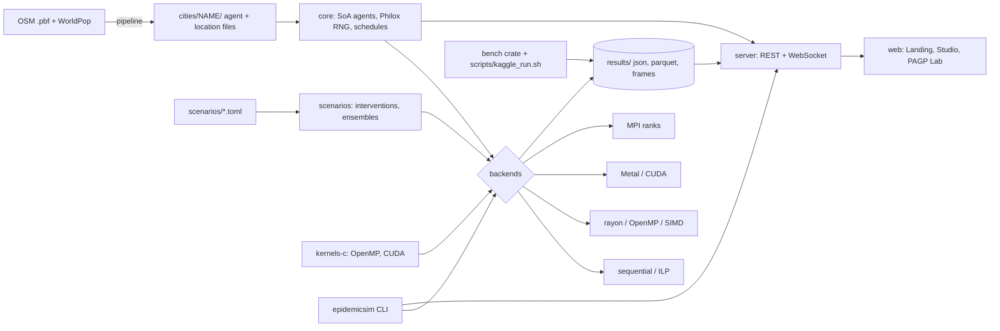

# epidemicsim

Agent-based epidemic simulator for Indian cities (up to 1M agents, 4 steps per day, SEIAHRD model) with interchangeable
parallel backends (sequential, ILP-optimised, rayon, OpenMP, SIMD, Metal, CUDA, MPI) that are tested to give identical
results, plus a web **Studio** (maps, live runs, scenario comparison) and a **PAGP Lab** (measured parallel-computing results).

Epidemic parameters are illustrative, not calibrated. Details: `docs/PROGRESS.md`, `docs/SCHEMA.md`, `docs/REPORT.md`.

## Architecture



Crates (`crates/`): `core`, `data`, `scenarios`, `backends`, `bench`, `mpi`, `server`, `cli`, `kernels-c`. Web app in `web/` (Vite, React, TypeScript, Recharts, deck.gl, light theme).

## Quickstart

```bash
git clone <this repo> && cd epidemicsim
scripts/setup.sh                 # checks prerequisites, builds release binary + web app (a few minutes, no downloads)
scripts/run.sh                   # serves API + web on http://127.0.0.1:8080  (scripts/run.sh 8081 for another port)
open http://127.0.0.1:8080/      # macOS; on Linux open the URL in a browser
```

Optional city data (for **Run live**): `scripts/setup.sh --cities mumbai,delhi`, or `./target/release/epidemicsim pipeline <city>`.

## Prerequisites

| | macOS (Apple Silicon or Intel) | Linux (x86_64 / aarch64) |
|---|---|---|
| Rust stable | required (`rustup`) | required (`rustup`) |
| Node.js 20.19+ or 22.12+ and npm | required (`brew install node`) | required (nodejs.org / nvm) |
| C compiler | `xcode-select --install` | `build-essential` |
| OpenMP backend | optional: `brew install libomp` | optional: gcc with libgomp (skipped automatically if missing) |
| MPI (`compare` over several processes, travel) | optional: `brew install open-mpi` | optional: `apt install libopenmpi-dev openmpi-bin libclang-dev` |
| Metal GPU backend | built automatically | not available |
| CUDA backend | not available | optional: `cargo build --release --features cuda`, NVIDIA GPU + driver at run time |

`scripts/setup.sh` never fails because an optional piece is missing: without MPI it builds with `--no-default-features`
(the multi-process `compare --mpi` and `--travel` under `mpirun` are then unavailable), without libomp the OpenMP backend is left out.
Checks (fmt, clippy, tests): `scripts/check.sh`. CI (`.github/workflows/ci.yml`) builds, runs all tests (including the golden tests) and builds the web app on Ubuntu.

## City data

`cities/<name>.toml`, `cities/<name>/locations.parquet` and `meta.json` are committed (Studio replay, maps and the Lab need only these plus `results/`).
`cities/<name>/agents.parquet` (about 11 MB per city) is **not** committed: it is only needed for **Run live**. Rebuild it with:

```bash
./target/release/epidemicsim pipeline bengaluru   # likewise mumbai, chennai, delhi (several at once is fine)
```

The pipeline downloads one Geofabrik zone extract into `data_cache/` (ignored): southern zone (Bengaluru, Chennai) about 560 MB, western zone (Mumbai) about 223 MB,
northern zone (Delhi) about 225 MB; a zone is downloaded once and reused. Measured here (Apple M-series, extract already downloaded): 16 s for a 100k-agent Chennai; the full 1M-agent builds were not re-timed. Download time depends on your connection.
The Studio shows the exact command for a city that is missing, and disables Run live (with the command) when only agent data is missing.

**What works without any city agent data:** the whole Lab and Landing, and Studio **Replay** of baked presets (`results/<city>/<scenario>/frames`), maps, charts and exports.
**What needs it:** Run live and the agent inspector.

## Run the server and web

```bash
scripts/run.sh                                 # production-style: server serves web/dist, one port (default 8080)
# dev mode, hot reload: server on 8080 plus the Vite dev server
./target/release/epidemicsim serve & cd web && npm run dev
```

Pages: `#/` landing, `#/studio`, `#/lab`, `#/demo` (one click). Lab data endpoints: `GET /api/lab/index`, `GET /api/lab/file/<path under results/>`.
Regenerate the report: `python3 -I scripts/gen_report.py` (writes `docs/REPORT.md`).

## Kaggle (NVIDIA GPU, x86 AVX2)

Follow `docs/KAGGLE.md`: upload the repo as a private dataset, enable a GPU and Internet, run `scripts/kaggle_run.sh`
(builds with `--features cuda`, runs tests, benchmarks, PTX and ncu, writes `results/kaggle/`).
To import: download the `results/kaggle/` folder from the notebook output, put it at `results/kaggle/` in this repo (replacing the old one), then run `python3 -I scripts/gen_report.py`; the Lab reads it directly.
Kaggle runs use 5 repetitions with no confidence intervals; Nsight Compute counters were unavailable there (see `docs/REPORT.md`, Limitations).

## Troubleshooting

- **Port in use** (`scripts/run.sh` says so): `scripts/run.sh 8081`, or `lsof -i :8080` to find the other process.
- **libomp not found** (macOS warning, OpenMP backend missing): `brew install libomp`; for a non-Homebrew path set `LIBOMP_PREFIX=/path/to/libomp` before building.
- **`mpirun` / `mpicc` missing**: only needed for MPI runs. Install open-mpi (see table), then `cargo build --release -p epidemicsim-cli`. Without it setup builds without MPI.
- **Node version error from Vite**: Node 20.19+ or 22.12+ is required; `node -v`, then upgrade.
- **Studio says a city is not built / Run live disabled**: run the command shown; Replay and the Lab still work.
- **`web/dist missing` from `scripts/run.sh`**: run `scripts/setup.sh` (or `cd web && npm ci && npm run build`).
- **Map tiles blank**: the basemap loads from a public tile server and needs internet access.

## Limitations

Epidemic parameters are illustrative and the calibration target (5-day doubling) is assumed. OpenACC was attempted but no compiler was available (no results).
Kaggle runs use 5 repetitions without confidence intervals; AVX2 was measured on one shared Xeon only; inter-city travel is CPU-only with assumed flows; Metal 10M results are not checked against sequential.
Full list: `docs/REPORT.md`.

## 5-minute demo script

1. **0:00** Open `http://127.0.0.1:8080/`. Say what it is; press **One-click demo**: the pre-baked Mumbai combined-interventions run replays on the map (SEIR curves, hospital load, Rt).
2. **1:00** In the Studio, pick **baseline** and press **Replay**, then switch to **lockdown**: two runs side by side with metric cards.
3. **2:00** Press **Run live** (100k agents, rayon). Pause, click an agent in the inspector to see its infection history.
4. **3:00** Open the **Lab**. *Performance*: speedup, efficiency, Amdahl serial fraction. *ILP*: naive vs optimised and the assembly diff.
5. **3:45** *GPU*: Metal and CUDA vs CPU with the time breakdown; *Warps* and *PTX*: branchy vs predicated, and the identical PTX across -O levels.
6. **4:30** *Summary*: backend x hardware matrix with golden-test status; point out the "not run" cards (ncu) and Metal 10M "not checked against sequential".
