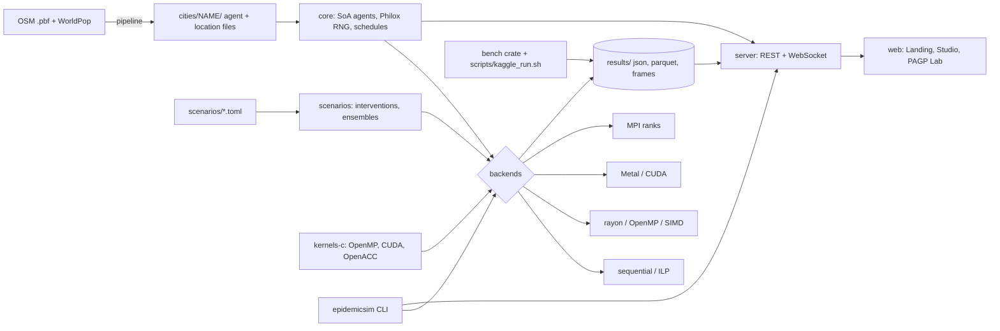

# epidemicsim

Agent-based epidemic simulator for Indian cities (up to 1M agents, 4 steps per day, SEIAHRD model) with interchangeable
parallel backends (sequential, ILP-optimised, rayon, OpenMP, SIMD, Metal, CUDA, MPI) that are tested to give identical
results, plus a web **Studio** (maps, live runs, scenario comparison) and a **PAGP Lab** (measured parallel-computing results).

Epidemic parameters are illustrative, not calibrated. Details: `docs/PROGRESS.md`, `docs/SCHEMA.md`, `docs/REPORT.md`.

## Architecture



Crates (`crates/`): `core`, `data`, `scenarios`, `backends`, `bench`, `mpi`, `server`, `cli`, `kernels-c`. Web app in `web/` (Vite, React, TypeScript, Recharts, deck.gl, light theme).

## Setup: Mac (Apple Silicon)

1. Rust stable (`rustup`), Node 20+, and for MPI: `brew install open-mpi`.
2. `cargo build --release` (Metal and NEON are built automatically on macOS/aarch64).
3. `cd web && npm install && npm run build`.
4. Optional city data: `./target/release/epidemicsim pipeline mumbai` (downloads OSM; see `cities/*.toml`). Cities already built appear in the Studio.
5. Checks: `scripts/check.sh` (fmt, clippy, tests).

## Setup: Kaggle (NVIDIA GPU, x86 AVX2)

Follow `docs/KAGGLE.md`: upload the repo as a private dataset, enable a GPU and Internet, run `scripts/kaggle_run.sh`
(builds with `--features cuda`, runs tests, benchmarks, PTX and ncu, writes `results/kaggle/`). Copy `results/kaggle/` back into this repo's `results/`.
Nsight Compute counters and OpenACC were unavailable on Kaggle (see `docs/REPORT.md`, Limitations).

## Run the server and web

```bash
./target/release/epidemicsim serve            # http://127.0.0.1:8080 (serves web/dist)
cd web && npm run dev                          # optional dev server (proxy/CORS to the API above)
```

Pages: `#/` landing, `#/studio`, `#/lab`, `#/demo` (one click). Lab data endpoints: `GET /api/lab/index`, `GET /api/lab/file/<path under results/>`.
Regenerate the report: `python3 -I scripts/gen_report.py` (writes `docs/REPORT.md`).

## 5-minute demo script

1. **0:00** Open `http://127.0.0.1:8080/`. Say what it is; press **One-click demo**: the pre-baked Mumbai combined-interventions run replays on the map (SEIR curves, hospital load, Rt).
2. **1:00** In the Studio, pick **baseline** and press **Replay**, then switch to **lockdown**: two runs side by side with metric cards.
3. **2:00** Press **Run live** (100k agents, rayon). Pause, click an agent in the inspector to see its infection history.
4. **3:00** Open the **Lab**. *Performance*: speedup, efficiency, Amdahl serial fraction. *ILP*: naive vs optimised and the assembly diff.
5. **3:45** *GPU*: Metal and CUDA vs CPU with the time breakdown; *Warps* and *PTX*: branchy vs predicated, and the identical PTX across -O levels.
6. **4:30** *Summary*: backend x hardware matrix with golden-test status; point out the "not run" cards (ncu, OpenACC) and Metal 10M "not checked against sequential".
